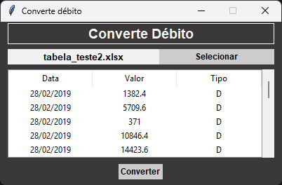
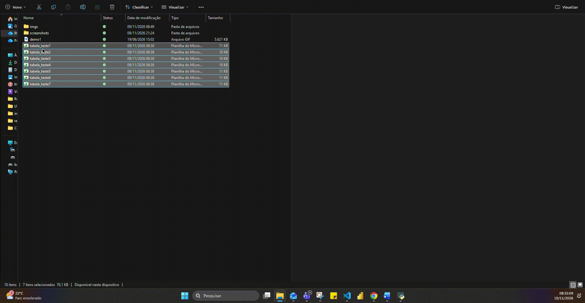

# 🚀 ConvertDebit


ConvertDebit é uma aplicação desktop desenvolvida com Tkinter para agilizar a inserção dados na [Plataforma de Gestão de Dívidas](https://divida.apps.tcu.gov.br/calculadora-debito).

## Objetivo

O projeto tem como objetivo agilizar a inserção dados por meio da conversão de um arquivo excel com um
padrão específico, contendo apenas 3 (três) colunas data/valor/tipo de débito, sendo a última coluna "D"
para débito e "C" para Crédito.
Além disso, pude aplicar conceitos, como a separação de responsabilidades e estruturar a aplicação em camadas: views e services.

## Tecnologias Utilizadas

Abaixo você encontra as tecnologias ultilizadas no projeto:

- Python 3.14+
- Tkinter
- Openpyxl
- Pandas
- Programação Orientada a Objetos (POO)

## Funcionalidades

- Selecionar
- Converter

---

## Estrutura

```bash
projeto-convert-debit/
│
├── docs
│   └── screenshots
│
└── src/
    │  
    ├── services/
    │   ├── convert_file.py
    │   ├── create_dir.py
    │   ├── load_file.py
    │   └── search_file.py
    │
    ├── views/
    │   └── form.py
    │
    ├── requirements.txt
    └── main.py
```

- **views** → Interface gráfica e eventos
- **services** → Regras de negócio  
- **src** → Orquestração da aplicação  

Essa separação permite:

- Redução de acoplamento
- Manutenabilidade

## Screenshots

### Principal



## Demonstração



---

## Como exercutar?

### 1) Clone o repositório

```bash

git clone https://github.com/CodePhsp/projeto-convertdebit.git
cd projeto-convertdebit
```

### 2) Crie ambiente virtual

Para o sistema operacional windows

> Dica: você pode escolher qualquer nome para seu ambiente virtual

```bash

python -m venv .venv
venv\Scripts\activate  
```

Para o sistema operacional Linux

```bash

python3 -m venv venv
source venv/bin/activate
```

### 3) Instale as dependências

```bash
python -m pip install -r requirements.txt
```

### 4) Execute

> Atenção: selecione a planilha modelo contida na pasta do projeto.

```bash
cd src
python main.py
```
